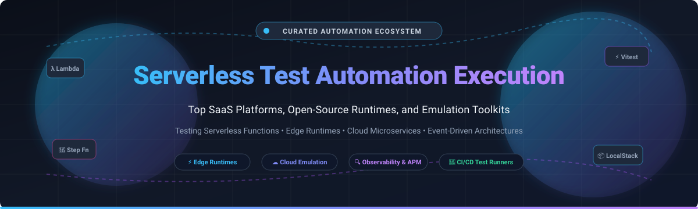

# ⚡ Awesome Serverless Test Automation Execution

  

  
  
  
  
  
  

> 🚀 **A curated directory of top Serverless Test Automation Execution platforms, testing frameworks, cloud emulators, and serverless observability suites.** Designed for developers building on AWS Lambda, Cloudflare Workers, Azure Functions, Google Cloud Run, and event-driven architectures.
> 🌟 *Star this repository to bookmark the latest serverless quality engineering tools!* 🌟

---

## 📋 Table of Contents

- [🌐 Sector Overview & Market Dynamics](#-sector-overview--market-dynamics)
- [🟦 SaaS / Hosted Platforms](#-saas--hosted-platforms)
- [🟩 Open-Source Software](#-open-source-software)
- [📊 Comparison at a Glance](#-comparison-at-a-glance)
- [🤝 Contributing](#-contributing)
- [💖 Support & Sponsorship](#-support--sponsorship)
- [📈 Star History](#-star-history)
- [📄 License](#-license)

---

## 🌐 Sector Overview & Market Dynamics

The global serverless computing and continuous test automation market represents an estimated **$24B–$29B sector in 2026** (projected to exceed $50B+ by 2030 at a ~15% CAGR), driven by rapid enterprise adoption of Function-as-a-Service (FaaS) and edge computing. The market dynamics are **moderately fragmented**: while cloud-wide enterprise observability and infrastructure monitoring display high concentration around dominant incumbents (e.g., Datadog, Dynatrace), the specialized serverless test automation and local emulation layer remains decentralized and highly developer-driven, fostering thriving open-source ecosystems alongside focused point solutions.

---

## 🟦 SaaS / Hosted Platforms

Commercial, cloud-hosted Serverless Test Automation Execution and Observability platforms. Sorted descending by company valuation / market capitalization.

| Product | Company Scale (Valuation / Revenue) | Pricing (Starting Tier) | Free Tier / Trial Limits | Core Focus & Runtime Target |
|:---|:---|:---|:---|:---|
| **[Datadog Serverless Monitoring](https://www.datadoghq.com/)** | ~$63B–$68B Market Cap (~$4B+ ARR) | **$5.00/month** per active function (Infra Pro) + **$10.00/million** traced invocations (APM) | **14-day free trial** with full access to APM, logs, and serverless metrics (no credit card required; downgrades to 5 hosts basic metric limit after trial) | Serverless observability, enhanced metrics, and distributed tracing for AWS Lambda, Azure App Service, and Cloud Run |
| **[BrowserStack Test Companion Cloud](https://www.browserstack.com/)** | ~$4B Valuation (~$225M ARR) | **$99.00/month** (Desktop Automate, 1 parallel execution slot) | **Free Trial with 60–100 minutes** of automated cross-browser execution across up to 5 parallel sessions (max 1 hour per test run) | Cloud-hosted parallel test execution runner across real browser sandboxes via VS Code |
| **[Lumigo](https://lumigo.io/)** | ~$100M–$250M Valuation ($37M raised, Acquired by Dash0) | **$99.00/month** (Standard Tier for higher volumes); **$0.00/month** (Free Basic Plan) | **Free forever plan** including up to **150,000 traces/month**, 5 GB logs/month, 5 GB metrics/month, and 14-day trace retention | Cloud-native serverless tracing and AI troubleshooting for AWS Lambda and microservices |
| **[Thundra](https://www.catchpoint.com/)** | ~$15M–$30M Est. Valuation ($4M raised, Acquired by Catchpoint) | **$90.00/month** (Standard Tier covering 10M invocations; enterprise sales via Catchpoint) | **Free plan limit of 1,000,000 invocations/month** (2 GB data allowance, 7-day retention, unlimited team seats) | Serverless observability with deep LocalStack integration for offline & local Lambda debugging |
| **[Dashbird](https://dashbird.io/)** | ~$5M–$15M Est. Valuation ($2.9M raised) | **$99.00/month** (Professional tier starting at 1M monthly invocations) | **14-day free trial** with full feature access and up to **5 GB data ingestion limit** (no credit card required) | Agentless AWS serverless observability, cost optimization, and automated error detection |

---

## 🟩 Open-Source Software

Community-driven, self-hosted tools and test runners for serverless functions, local cloud emulation, and event-driven architectures. **Sorted descending by GitHub_Stars_Count.**

### 1. [LocalStack](https://github.com/localstack/localstack) 
- **Repository:** [`localstack/localstack`](https://github.com/localstack/localstack)
- **License:** Apache-2.0
- **Stack:** Python / Docker
- **Description:** A complete, local AWS cloud emulator running inside Docker. Enables full offline development, automated integration testing, and CI pipeline validation for AWS Lambda, S3, DynamoDB, SQS, SNS, and Step Functions without touching real cloud resources.

### 2. [Serverless Framework](https://github.com/serverless/serverless) 
- **Repository:** [`serverless/serverless`](https://github.com/serverless/serverless)
- **License:** Serverless Public License / MIT (v3)
- **Stack:** Node.js / TypeScript
- **Description:** The industry-standard CLI framework to build, package, test, and deploy serverless applications across AWS Lambda, Cloudflare Workers, and Azure. Powers local test invocation via `serverless invoke local`.

### 3. [Cloudflare workerd](https://github.com/cloudflare/workerd) 
- **Repository:** [`cloudflare/workerd`](https://github.com/cloudflare/workerd)
- **License:** Apache-2.0
- **Stack:** C++ / V8 / JavaScript
- **Description:** The open-source JavaScript/Wasm runtime that powers Cloudflare Workers at the edge. Serves as the foundation for local test execution engines like Miniflare and the Workers Vitest test integration.

### 4. [Moto](https://github.com/getmoto/moto) 
- **Repository:** [`getmoto/moto`](https://github.com/getmoto/moto)
- **License:** Apache-2.0
- **Stack:** Python
- **Description:** An open-source mocking library for AWS infrastructure. Allows automated tests to simulate calls to AWS Lambda, DynamoDB, S3, and dozens of other cloud services in pure memory without spinning up Docker or real cloud infrastructure.

### 5. [AWS SAM CLI](https://github.com/aws/aws-sam-cli) 
- **Repository:** [`aws/aws-sam-cli`](https://github.com/aws/aws-sam-cli)
- **License:** Apache-2.0
- **Stack:** Python / Docker
- **Description:** The official AWS Serverless Application Model command-line interface. Features local test invocation (`sam local invoke`), local API gateway emulation (`sam local start-api`), and integration with LocalStack for offline test automation execution.

### 6. [serverless-offline](https://github.com/dherault/serverless-offline) 
- **Repository:** [`dherault/serverless-offline`](https://github.com/dherault/serverless-offline)
- **License:** MIT
- **Stack:** Node.js / JavaScript
- **Description:** A popular Serverless Framework plugin that emulates AWS Lambda and API Gateway locally on your machine, enabling rapid automated integration testing and local HTTP request verification.

### 7. [Cloudflare Workers SDK (Vitest & createTestHarness)](https://github.com/cloudflare/workers-sdk) 
- **Repository:** [`cloudflare/workers-sdk`](https://github.com/cloudflare/workers-sdk)
- **License:** Apache-2.0 / MIT
- **Stack:** TypeScript / Wrangler
- **Description:** Contains the official Workers Vitest test pool runner and the `createTestHarness()` API for executing isolated unit and end-to-end integration tests directly inside the `workerd` edge runtime environment.

### 8. [AWS Serverless Test Samples](https://github.com/aws-samples/serverless-test-samples) 
- **Repository:** [`aws-samples/serverless-test-samples`](https://github.com/aws-samples/serverless-test-samples)
- **License:** MIT-0
- **Stack:** Python / TypeScript / Java
- **Description:** Official reference test automation architecture from AWS. Demonstrates enterprise patterns for unit testing, integration testing, and synthetic end-to-end test suites for event-driven serverless architectures.

### 9. [aws-testing-framework](https://github.com/sophiegle/aws-testing-framework) 
- **Repository:** [`sophiegle/aws-testing-framework`](https://github.com/sophiegle/aws-testing-framework)
- **License:** MIT
- **Stack:** TypeScript / Cucumber BDD
- **Description:** Open-source BDD test framework for AWS serverless applications. Validates actual Lambda execution via CloudWatch metrics and log events rather than basic resource deployment checks.

---

## 📊 Comparison at a Glance

| Tool / Platform | License | Scale / Stargazers | Category | Runtime Target | Execution Type | Best For |
|:---|:---|:---|:---|:---|:---|:---|
| **LocalStack** | Apache-2.0 |  | Open-Source Emulator | AWS Ecosystem | Local Emulation | Complete offline AWS environment testing |
| **Serverless Framework** | Source / MIT |  | Open-Source CLI | AWS, GCP, Cloudflare | Local / Cloud Execution | Deploying and invoking functions locally |
| **Cloudflare workerd** | Apache-2.0 |  | Open-Source Runtime | Cloudflare Workers | Native Runtime Exec | Edge runtime emulation & testing |
| **Moto** | Apache-2.0 |  | Open-Source Mocking | AWS Lambda & Services | In-Memory Mocking | Fast Python unit testing with mocked AWS |
| **AWS SAM CLI** | Apache-2.0 |  | Open-Source CLI | AWS Lambda & API Gateway | Local Container Exec | Native SAM template testing and API emulation |
| **serverless-offline** | MIT |  | Open-Source Plugin | AWS Lambda / HTTP | Local Server Emulation | Local Node.js API simulation |
| **Cloudflare Workers SDK** | Apache-2.0 |  | Open-Source SDK | Cloudflare Workers | Vitest / Runtime Exec | Edge function unit & integration testing |
| **Datadog Serverless** | Proprietary | ~$63B–$68B Market Cap | Commercial SaaS | AWS, Azure, GCP | Observability & Tracing | Enterprise production serverless diagnostics |
| **BrowserStack Companion** | Proprietary | ~$4B Valuation | Commercial SaaS | Web & Cloud Sandboxes | Cloud Execution | AI-assisted parallel browser testing |
| **Lumigo** | Proprietary | ~$100M–$250M Valuation | Commercial SaaS | AWS Lambda & Microservices | Observability & AI Tracing | Distributed trace inspection & debugging |
| **AWS Serverless Samples** | MIT-0 |  | Reference Suite | AWS Lambda & EventBridge | Best-Practice Suite | Reference integration & E2E blueprints |
| **Thundra** | Proprietary | ~$15M–$30M Valuation | Commercial SaaS | AWS Lambda / LocalStack | Observability & Debugging | LocalStack Lambda trace monitoring |
| **Dashbird** | Proprietary | ~$5M–$15M Valuation | Commercial SaaS | AWS Serverless | Observability & Auditing | Agentless serverless error & cost detection |
| **aws-testing-framework** | MIT |  | Open-Source Framework | AWS Lambda & Step Functions | BDD Execution | Log-verified BDD assertions on AWS |

---

## 🤝 Contributing

Contributions are always warmly welcomed! 🌟 To add an open-source tool, testing harness, or serverless execution framework to this repository:

1. 🍴 **Fork** this repository.
2. 🌿 **Create a new branch**: `git checkout -b add-my-serverless-tool`.
3. 📝 **Add your project** in the appropriate section with its name, GitHub repository link, license, and brief description.
4. 🚀 **Commit and push** your changes.
5. 📬 **Submit a Pull Request** explaining what makes the tool uniquely suited for serverless test automation execution.

---

## 💖 Support & Sponsorship

If you find this curated ecosystem list helpful for your serverless testing workflows, please consider supporting the project:

- ⭐ **Star this repository** to help others discover it!
- 🍴 **Fork and share** it with your developer community.
- ☕ **Buy me a coffee & support my open-source work**: Sponsor the creator via the [GitHub Sponsors Dashboard](https://github.com/sponsors/ishandutta2007).

Thank you for being part of the open-source community! 🙌

---

## 📈 Star History

---

## 📄 License

This compilation is licensed under the [Creative Commons Zero v1.0 Universal](LICENSE) (CC0 1.0 - Public Domain). Individual projects and platforms listed herein retain their respective licenses and trademarks.

---

  Curated with ❤️ by <a href="https://github.com/ishandutta2007">Ishan Dutta</a> and the global serverless community.

